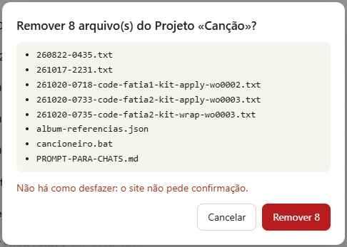
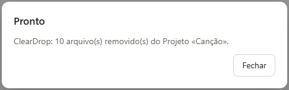

# ClearDrop

Esvazia de uma vez os **arquivos de conhecimento** de um Projeto do claude.ai — e só eles —, nas contas cuja lista de arquivos ainda não tem «Selecionar» (o layout de transição de out/2026). Onde a lista já tem «Selecionar → Selecionar tudo → Excluir», o ClearDrop se recusa e aponta o recurso nativo.

Irmão do FlatDrop: um achata o repositório e sobe; o outro esvazia antes de subir.

## Instalar (uma vez)
1. No Chrome, abra `chrome://extensions`.
2. Ligue **Modo do desenvolvedor** (canto superior direito).
3. **Carregar sem compactação** → escolha a pasta `extension/` deste repositório.
4. No ícone de quebra-cabeça da barra, **fixe** o ClearDrop.
5. Recarregue (F5) as abas do claude.ai que já estavam abertas.

Para atualizar depois de um `git pull`: em `chrome://extensions`, clique no ↻ do ClearDrop e recarregue a aba.

## Usar
1. Abra o Projeto no claude.ai (não precisa abrir a lista de arquivos).
2. Clique no ícone do ClearDrop.
3. Confira na janela o nome do Projeto, a contagem e a lista → **Remover** (ou **Cancelar** / Esc).
4. Acompanhe o progresso; **Parar** interrompe depois do arquivo da vez. Clicar no ícone de novo continua dos que restaram.

**Não há como desfazer**, e o site não pede confirmação ao remover: a janela do ClearDrop é a única barreira.

## Quanto tempo leva
Cerca de 3 segundos por arquivo com a aba à vista: é o tempo que o próprio site leva para remover um arquivo e recarregar a lista, mais uma pausa curta entre eles, de propósito.

Pode minimizar ou trocar de aba: a remoção continua. Mas o Chrome desacelera abas ocultas, e depois de alguns minutos fora de vista desacelera bastante. Para terminar rápido, deixe a aba à vista. Se algo der errado, a janela diz quantos saíram e onde parou; clicar no ícone de novo continua dos que restaram.

## O que ele não toca
Conversas, Instruções, outros Projetos e qualquer coisa fora do claude.ai. A extensão não pede permissão nenhuma além de rodar no claude.ai, não guarda nada e não fala com servidor nenhum: ela só clica na página, como você clicaria.

## Sem instalar (Console)
Com o Projeto aberto: F12 → Console → cole `extension/cleardrop.js` inteiro → `ClearDrop.scan()` (ensaio, não remove) ou `ClearDrop.run()` (pede para digitar o nome do Projeto).

## Por que a extensão fica na pasta `extension/`
O Chrome se recusa a carregar uma extensão cuja pasta tenha arquivos começando com `_`, e este repositório tem `_TEMPLATE.md` em `meta/`. Por isso a extensão vive numa pasta só dela. Isso não tem nada a ver com os arquivos do seu Projeto: um `_TEMPLATE.md` subido ao Projeto é removido como qualquer outro.

## Desenvolvimento
- `npm install` uma vez; `npm test` roda os testes em jsdom sobre o HTML medido do site (`tests/fixtures/`).
- Contexto, decisões e estado: `meta/` (comece por `meta/CONTEXT.md`).
